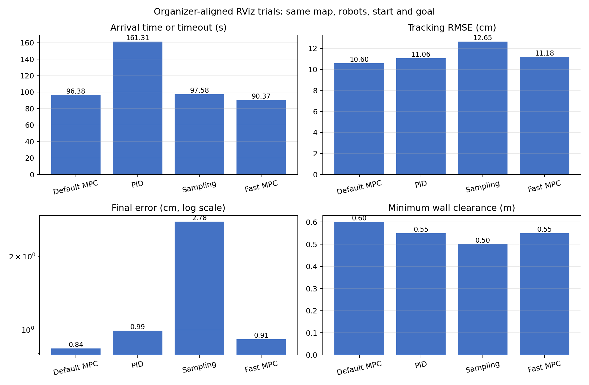
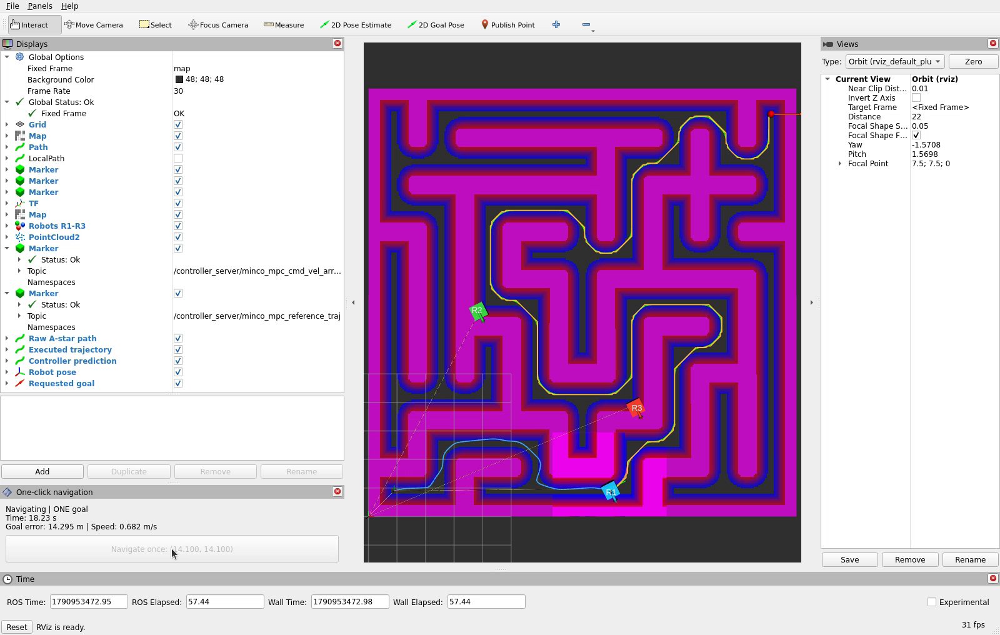
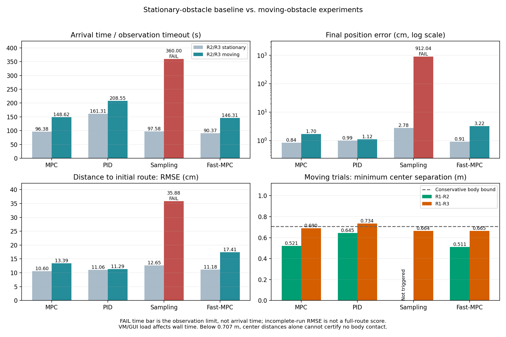
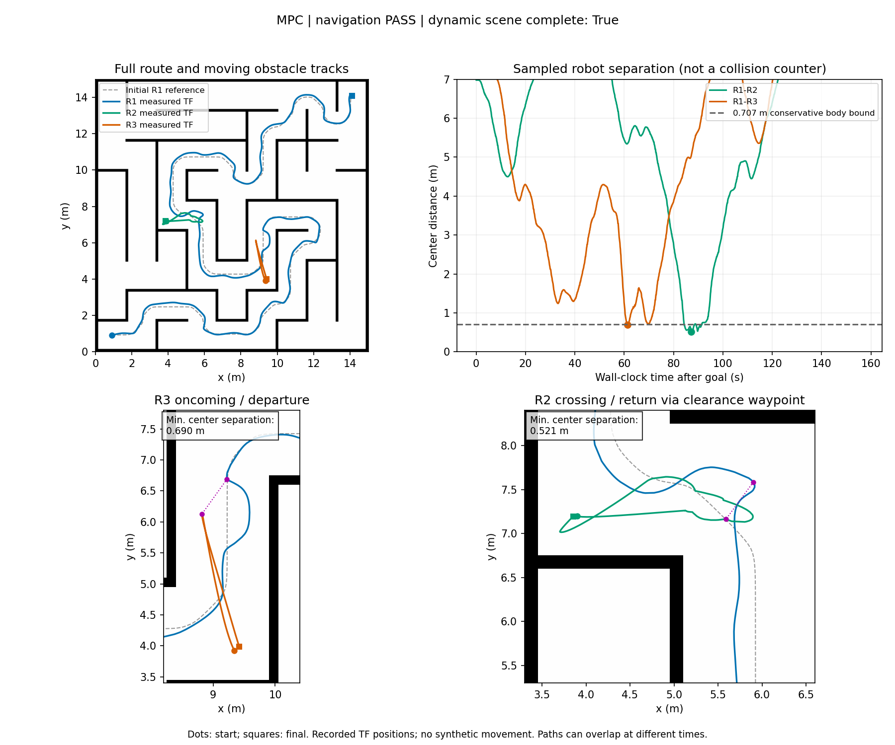

# RM navigation final project

Ubuntu 22.04 / ROS 2 Humble 下的固定迷宫单次点击导航。实现 PID、带输入延迟补偿的线性 MPC，以及独立的平滑采样预测实验控制器。

作者账号：`sutinah12-hash`。提交分支：`nav`。官方来源：[TongjiSuperPower/sp_vision_tutorial_27 / final_project_nav](https://github.com/TongjiSuperPower/sp_vision_tutorial_27/tree/final_project_nav)，本次核对版本 `05c33fc8aa6695e76bcff310b42f8fdfe276e1cb`。

[原始作业要求](docs/assignment.md) · [运行步骤](docs/run_guide.md)  · [三种控制方法](docs/controller_methods.md) · [开发与验证记录](docs/implementation_status.md)

**原先的实验：R2、R3 静止。**[默认 MPC](docs/evidence/final_visible_mpc_rviz_01/rviz_one_click.mp4) · [PID](docs/evidence/final_visible_pid_rviz_02/rviz_one_click.mp4) · [Sampling](docs/evidence/final_visible_sampling_rviz_01/rviz_one_click.mp4) · [Fast MPC](docs/evidence/final_visible_fast_mpc_rviz_01/rviz_one_click.mp4)。这四段验证静止障碍场景，不能作为移动障碍避让证据。

**新增的实验：R2、R3 实际移动进入 R1 路线。**[默认 MPC](docs/evidence/moving_mpc_rviz_01/rviz_one_click.mp4) · [PID](docs/evidence/moving_pid_rviz_01/rviz_one_click.mp4) · [Sampling](docs/evidence/moving_sampling_rviz_01/rviz_one_click.mp4) · [Fast MPC](docs/evidence/moving_fast_mpc_rviz_01/rviz_one_click.mp4)。四组共用位置触发的迎面接近、横穿及返回规则；每轮仍只有一次 R1 导航目标。

[录像与指标对比](docs/video_comparison.md) · [移动场景、原始证据与复现步骤](docs/dynamic_obstacles.md)。地图、仿真参数和起终点不变，分别比较静止、移动两类场景。

**快速 MPC 静止障碍基线：**速度上限 2.0 m/s、最大加速度 2.0 m/s²、制动加速度 1.2 m/s²、横向加速度 1.0 m/s²。完整 RViz 单击试验用时 **90.37 s**，终点误差 **0.91 cm**，最小墙距 **0.55 m**。

## 1. Task and compliance

固定起点 `(0.900, 0.900)`，固定终点 `(14.100, 14.100)`。一次目标通过上层 `click_nav.xml` 触发导航 action，再由下层 `default_nav_with_fallback.xml` 调用 A* 和控制器。没有绕过双层行为树，没有人工发布 R1 速度、拖动 R1 或途中更改它的目标。移动组只通过原版右键功能设置 R2/R3 的行驶目标，由原版动力学驱动，不瞬移障碍车。

原来的 lecture1–5 和个人仓库历史保留；导航源码在 `src/`。虚拟机使用独立的 `/home/zrj/nav_final_project`，不覆盖此前课程工作区。所有跟踪文件名使用 ASCII。

## 2. Run it

在已经安装完成的 VMware **Ubuntu 桌面终端**运行：

```bash
cd /home/zrj/nav_final_project
source /opt/ros/humble/setup.bash
source install/setup.bash
python3 scripts/run_trial.py --controller mpc --out results/my_mpc_01
```

等待 RViz 的 `One-click navigation` 按钮就绪，点击一次 `Navigate once: (14.100, 14.100)`。主办方原有的 `2D Goal Pose` 工具仍保留；正式固定终点实验用按钮保证四组目标完全相同。不要使用 `2D Pose Estimate` 或重复发目标。结束后 `data/metrics.json` 给出到达判定，`samples.csv` 保存原始采样，`trajectory.png` 为真实数据生成的轨迹图。重新运行时使用新的输出目录名称。

换控制器只改参数：`--controller pid` 或 `--controller sampling`。每次等待上一轮结束，不同时运行多套仿真。

全新克隆、依赖安装、编译和常见问题见 [run guide](docs/run_guide.md)。编译测试命令：

```bash
source /opt/ros/humble/setup.bash
colcon build --base-paths src --symlink-install --executor sequential --cmake-args -DCMAKE_BUILD_TYPE=Release -DBUILD_TESTING=ON
source install/setup.bash
colcon test --base-paths src --executor sequential
colcon test-result --verbose
```

## 3. Overview

`RViz 单次目标 → 上层决策 BT → NavigateToPose action → 下层导航 BT → A* / controller plugin → 仿真反馈`

- `/global_costmap`：地图服务器发布的全局膨胀代价地图。
- `/local_costmap/costmap`：包含附近动态占据；`/robots → robot_marker_publisher → /dynamic_obstacles/markers` 把三台机器人的实测位姿显示为 R1、R2、R3。该支路只负责显示，不参与规划或控制。
- `/global_path_raw` / `/global_path`：原始 A* / 安全平滑后的路径。
- `/Odometry` 和 TF：定位与速度反馈；固定 `map → lidar_odom` 平移由原版仿真提供。
- `/sentry/cmd_vel`：控制器转换到旋转的 `base_link` 后输出的速度。
- `/mpc_prediction` / `/executed_path`：预测轨迹 / 测得的执行轨迹。
- `/controller_compute_ms`：控制回调自身计算耗时，不等于全系统 CPU 使用率。

配置集中在 `src/sp_nav_bringup/config/nav_params.yaml`，仿真参数在 `src/sp_nav_sim/config/sim_robot.yaml`，组合启动文件是 `project.launch.py`。控制器通过 pluginlib 注册并实现 `configure`、`setPlan`、`computeVelocityCommands`。完整启动顺序和数据流见 [架构与代码讲解](docs/architecture_guide.md)。

## 4. Planner and smoothing

A* 在膨胀代价地图上搜索，并禁止对角穿过障碍角。将确切起终点保留下来，对中间点进行弹性平滑：兼顾不偏离原路径和减小二阶差分，每点位移限制为 0.20 m，最多 120 轮。

每次候选调整均检查代价和相邻线段；采用精确线段与障碍格矩形相交检测，避免稀疏采样漏掉角落。端点固定，最终整段复检；不安全则回退原路径。路径参考还包含曲率限速和终点制动剖面。

这验证的是参考路径的安全性，不等于有限误差跟踪下的整机安全保证。实际运行还需要观察轨迹与墙面净空。

## 5. Controllers

**PID baseline**：路径切向速度前馈，加最近投影点横向位置反馈、积分限幅和速度反馈。接近终点后使用无前馈阻尼位置调节，防止绕终点振荡。按主办方代价地图重新调节后，PID 使用 1.0 m/s 指令上限、提前制动和较低弯道速度，在两轮自动回归及最终 RViz 单击试验中均完整到达。

**Delay-compensated linear MPC (default)**：状态为世界坐标 `px, py, vx, vy`，输入为期望速度 `ux, uy`。模型：

```text
alpha = exp(-dt / tau)
v[k+1] = alpha*v[k] + (1-alpha)*u[k]
p[k+1] = p[k] + dt*v[k+1]
```

从课程原版动力学的固定朝向阶跃响应拟合得到延迟约 0.2147 s、时间常数约 0.3145 s。使用 28 步、0.07 s 预测间隔，前 3 步由已发送命令固定，滚动优化剩余指令。位置、速度、指令变化和幅度构成凸二次代价；输入合速度圆盘约束通过投影加速梯度求解，最多 100 次迭代。严格说这是带二次约束的凸优化，并非完整非线性 MPC。

**Smooth sampling predictive (experimental)**：同样的参考路径和延迟队列，评估 257 条平滑扰动序列、3 轮加权更新，并在预测中考虑速度与加速度限幅。它是受 MPPI 启发的实验实现，与 Nav2 MPPI / SVG-MPPI 的差异见 [controller methods](docs/controller_methods.md)，运行时不会回退到 MPC。

默认 MPC 与 Sampling 使用 1.25 m/s 指令上限和 1.7 m/s² 指令变化限幅；PID 使用 1.0 m/s、2.0 m/s²，并采用 `braking_acceleration=0.45`、`lateral_acceleration=0.35`。这些都是学生控制器参数，没有改原版仿真器的 2.0 m/s、2.0 m/s² 物理上限。MPC 的最终变化限幅未完整建模到优化约束中，是已知近似。

## 6. Evidence and evaluation

测试环境：VMware Ubuntu 22.04，8 vCPU / 8 GB RAM，系统 Python 3.10、ROS 2 Humble，Release 编译。保留四组静止障碍基线，并新增四组移动障碍录像。每类内部只切换控制器及明确标注的 Fast MPC 参数，地图、物理模型、频率和起终点不变。

统计依据是每轮保留的原始日志、路径、时间序列和 `provenance.json`，而非截图估算。评测规则：

- 目标恰好一条，起点偏差小于 0.03 m，目标是指定坐标。
- ROS navigation action 成功后，再等待 4 秒，终点误差小于 0.05 m、速度小于 0.08 m/s 才记为 PASS。
- 耗时为接收目标到 action 成功的墙钟时间；终点误差是上述等待后的值，两者不混淆。
- 跟踪误差是实测位置到**首次全局参考路径线段**的最近距离，冻结参考避免重规划造成误差虚低。
- 静态墙净空是中心到占据像素的近似距离，不冒充仿真器直接提供的碰撞计数。
- 静止和移动场景各保留四段录像；到达 PASS 不等于全程无车体接触。

逐轮证据位于 [docs/evidence](docs/evidence)，可使用 `scripts/summarize_trials.py` 从所列试验目录重新计算汇总。自动回归的 `trigger=single_topic_message_test`，GUI 验收的 `trigger=rviz_click`，不会把自动发布目标说成手工点击。

编译结果：9 个包成功；`colcon test-result` 汇总 21 项检查，0 errors、0 failures、0 skipped。仿真采样等价测试覆盖 190 个案例、506861 个格子，并验证未修改文件哈希。

### Stationary-obstacle baseline

四轮都在完整主办方 RViz 配置上运行：Grid、全局/局部代价地图、Path、LocalPath、规划标记、TF、动态障碍、点云和原控制器标记均保留；原始 A*、执行轨迹、预测轨迹、机器人坐标轴和目标箭头作为附加显示。仿真日志均启动 `robots=[1, 2, 3]`。`robot_marker_publisher` 订阅主办方已有的 `/robots`，仅把三台机器人的位姿画成青色 R1、绿色 R2、红色 R3，并不改变仿真状态、代价地图或控制结果。

|配置|结果|Action 时间|终点误差|跟踪 RMSE|最小墙距|视频长度|
|---|---:|---:|---:|---:|---:|---:|
|默认 MPC|PASS|96.38 s|0.84 cm|10.60 cm|0.60 m|104.9 s|
|PID|PASS|161.31 s|0.99 cm|11.06 cm|0.55 m|171.4 s|
|Sampling|PASS|97.58 s|2.78 cm|12.65 cm|0.50 m|107.4 s|
|Fast MPC|PASS|90.37 s|0.91 cm|11.18 cm|0.55 m|100.0 s|

默认 MPC、Sampling 和 Fast MPC 来自干净提交 `3b9ea6c`，调优后的 PID 来自干净提交 `4208f16`。四轮 `metrics.json` 均记录 `trigger=rviz_click`、`goal_messages=1`、起点 `(0.9, 0.9)`、终点 `(14.1, 14.1)` 和 `action_status=4`。视频均为 1600×1016、H.264、10 fps 的原速连续窗口捕获，已完整解码检查；每个目录另存视频 20 秒处的实际画面。





### Moving-obstacle experiments

R3 在右侧通道迎面接近后驶离，R2 在中部转弯处横穿后返回。触发区和障碍路点四组一致；三车 TF 按共享时间戳配对，另存运动轨迹与原生右键事件。绿色、红色短轨迹分别显示 R2、R3 实际驶过的位置。

|配置|导航结果|到达时间|终点距离|实际动态交互|
|---|---|---:|---:|---|
|默认 MPC|PASS|148.62 s|1.70 cm|R3、R2 均完成|
|PID|PASS|208.55 s|1.12 cm|R3、R2 均完成|
|Sampling|FAIL|未到达|9.12 m|R3 会车后中止，R2 未触发|
|Fast MPC|PASS|146.31 s|3.22 cm|R3、R2 均完成|

Sampling 在约 **79.86 s** 时因当前位置落入不可通行代价格、规划重试失败而中止；记录器继续观察至 360 s，失败录像完整保留。四组测试源码均为 `7c57d2b`。三组到达不代表已经证明全程无车体接触，尤其 R1 与 R2 最近中心距离只有约 0.51–0.65 m。





到达判定沿用上面的标准，动态场景另外核对两车位移、运动时进入参考路线的采样和返回状态。最近中心距离不是碰撞计数；低于约 0.707 m 时，仅凭该数据不能确认旋转方形车体始终无接触。

旧静止组不是本轮同负载重录；新增三车采样、双窗口及当前虚拟机负载也会影响墙钟时间，不能把新旧时间差全部算作避障开销。移动场景的参考路线偏差还包含主动绕行。逐轮数字和会车画面见 [video comparison](docs/video_comparison.md)。

`docs/evidence/` 保留上述八段录像、最新对比图、对应原始数据，以及构建、动力学和仿真等价性检查。

## 7. Reproduce and extend

自动重复回归：

```bash
python3 scripts/run_trial.py --controller mpc --headless --auto-goal --out results/test_mpc_01
python3 scripts/run_trial.py --controller pid --headless --auto-goal --out results/test_pid_01
python3 scripts/run_trial.py --controller sampling --headless --auto-goal --out results/test_sampling_01
python3 scripts/run_trial.py --controller mpc --no-smoothing --headless --auto-goal --out results/test_raw_01
python3 scripts/verify_sampling_equivalence.py --out results/test_equivalence_01
```

每轮 `provenance.json` 记录提交号、工作区状态、参数与开始时间。`build/`、`install/`、`log/`、完整开发期 `results/` 均忽略；只将经检查的最终证据复制到 `docs/evidence/`。
