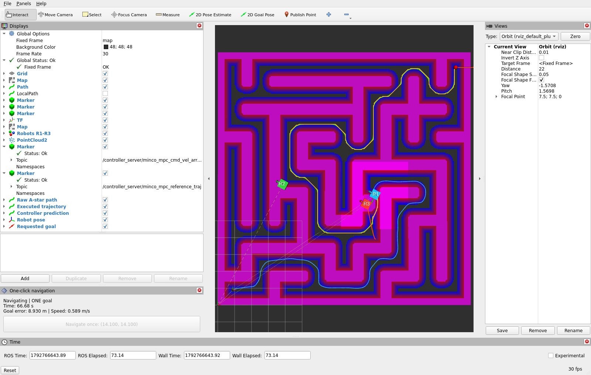

# Stationary and moving obstacle videos

原先四组是 **R2、R3 静止**的基线；新增四组让障碍车实际移动进入 R1 行驶路线。八段均为 VMware Ubuntu 22.04 真实 RViz 窗口录像，固定起点 `(0.9,0.9)`、终点 `(14.1,14.1)`，每轮只有一条 R1 导航目标。

## Moving obstacles: new experiments

- [默认 MPC 视频](evidence/moving_mpc_rviz_01/rviz_one_click.mp4)：到达 PASS，148.62 s，终点距离 1.70 cm；R3、R2 两次交互均完成。
- [PID 视频](evidence/moving_pid_rviz_01/rviz_one_click.mp4)：到达 PASS，208.55 s，终点距离 1.12 cm；R3、R2 两次交互均完成。
- [Sampling 视频](evidence/moving_sampling_rviz_01/rviz_one_click.mp4)：FAIL；R3 会车后导航中止，R2 未触发，最终仍距终点 9.12 m。
- [Fast MPC 视频](evidence/moving_fast_mpc_rviz_01/rviz_one_click.mp4)：到达 PASS，146.31 s，终点距离 3.22 cm；R3、R2 两次交互均完成。

|配置|到达时间|首次参考路线 RMSE|最小墙距|R1–R2 最近中心距离|R1–R3 最近中心距离|视频长度|
|---|---:|---:|---:|---:|---:|---:|
|默认 MPC|148.62 s|13.39 cm|0.35 m|0.521 m|0.690 m|159.3 s|
|PID|208.55 s|11.29 cm|0.46 m|0.645 m|0.734 m|219.9 s|
|Sampling|未到达|35.88 cm（未完成全程）|0.30 m|未触发|0.664 m|368.7 s|
|Fast MPC|146.31 s|17.41 cm|0.35 m|0.511 m|0.665 m|156.6 s|

四组测试源码均来自干净提交 `7c57d2b`，场景为 `two_position_triggered_encounters_v3`。R3 在右侧通道迎面接近后驶离，R2 在中部转弯处横穿后返回；触发看 R1 位置，不看固定秒数。仿真器、控制器源码及仿真参数没有为这四组测试改动。具体路点和复现命令见 [dynamic experiments](dynamic_obstacles.md)。

### Sampling failure

本轮在约 **79.86 s** 收到 `Action ABORTED`。日志连续出现 `Start is in blocked cell (cost=100)`，随后记录 `Navigation task failed`。机器人停在约 `(9.611,6.161)`，未到达 R2 的触发区域。

这是本场景、现有参数下的失败结果。录像保留到原定 360 s 观察上限，因此 `metrics.json` 的 `reason=timeout` 与 `action_status=6` 同时出现；360 s 不是到达时间，也不是 action 实际中止时刻。日志时间复算保存在 [navigation diagnostics](evidence/moving_sampling_rviz_01/navigation_diagnostics.json)。

### Actual trajectories and native frames

[MPC 轨迹](evidence/moving_mpc_rviz_01/dynamic_trajectories.png) · [PID 轨迹](evidence/moving_pid_rviz_01/dynamic_trajectories.png) · [Sampling 轨迹](evidence/moving_sampling_rviz_01/dynamic_trajectories.png) · [Fast MPC 轨迹](evidence/moving_fast_mpc_rviz_01/dynamic_trajectories.png)

[MPC 会车画面](evidence/moving_mpc_rviz_01/native_encounter.png) · [PID 会车画面](evidence/moving_pid_rviz_01/native_encounter.png) · [Fast MPC 会车画面](evidence/moving_fast_mpc_rviz_01/native_encounter.png)

绿色、红色短轨迹为 R2、R3 实际驶过的位置；蓝色为 R1 执行轨迹，橙黄色为原始 A*。图表由原始 TF 绘制，`native_encounter.png` 则直接从对应 MP4 抽帧，两类图片分别标明来源。

## Stationary obstacles: previous baseline

这四段中三台机器人都可见，但 R2、R3 没有行驶，不能作为移动障碍验证。

- [默认 MPC](evidence/final_visible_mpc_rviz_01/rviz_one_click.mp4)：PASS，96.38 s，终点距离 0.84 cm。
- [PID](evidence/final_visible_pid_rviz_02/rviz_one_click.mp4)：PASS，161.31 s，终点距离 0.99 cm。
- [Sampling](evidence/final_visible_sampling_rviz_01/rviz_one_click.mp4)：PASS，97.58 s，终点距离 2.78 cm。
- [Fast MPC](evidence/final_visible_fast_mpc_rviz_01/rviz_one_click.mp4)：PASS，90.37 s，终点距离 0.91 cm。

静止组的默认 MPC、Sampling、Fast MPC 来自 `3b9ea6c`，PID 来自 `4208f16`。原始数据和录像保留在 `final_visible_*` 目录中。

## How to compare

- **到达和无接触分开。** PASS 要求 action 成功，等待 4 s 后终点误差小于 5 cm、速度小于 0.08 m/s。现有记录没有接触计数。对边长 0.50 m 的旋转方形车体，中心距大于约 0.707 m 才满足与朝向无关的保守分离条件；表中多个最近距离低于该值，不能据此宣称全程无接触。
- **时间包含系统负载。** 新增三车采样和双窗口，且旧静止组不是本轮同负载重录，不能把新旧耗时差都解释成避障开销。Fast MPC 本轮比默认 MPC 快约 2.32 s，但参考路线偏差更大，单轮不能说明稳定优于默认方案。
- **RMSE 要结合路线完成度。** 绕行会偏离首次参考路线；Sampling 的数值还包含中止后的静止采样，不能与成功跑完全程的结果等价排序。
- **不是四个预测避障器的比较。** 动态占据先进入局部代价地图，再由 A* 重规划，控制器负责跟踪。当前控制器没有显式预测 R2/R3 未来轨迹的碰撞约束。

每轮保留 MP4、启动日志、来源提交、唯一目标记录、三车共享时间戳 TF、障碍目标事件和完整解码报告。四段新视频均为 1600×1016、H.264、10 fps、原速连续录制，没有拼接或加速；`video_validation.json` 记录长度和抽帧时刻。
