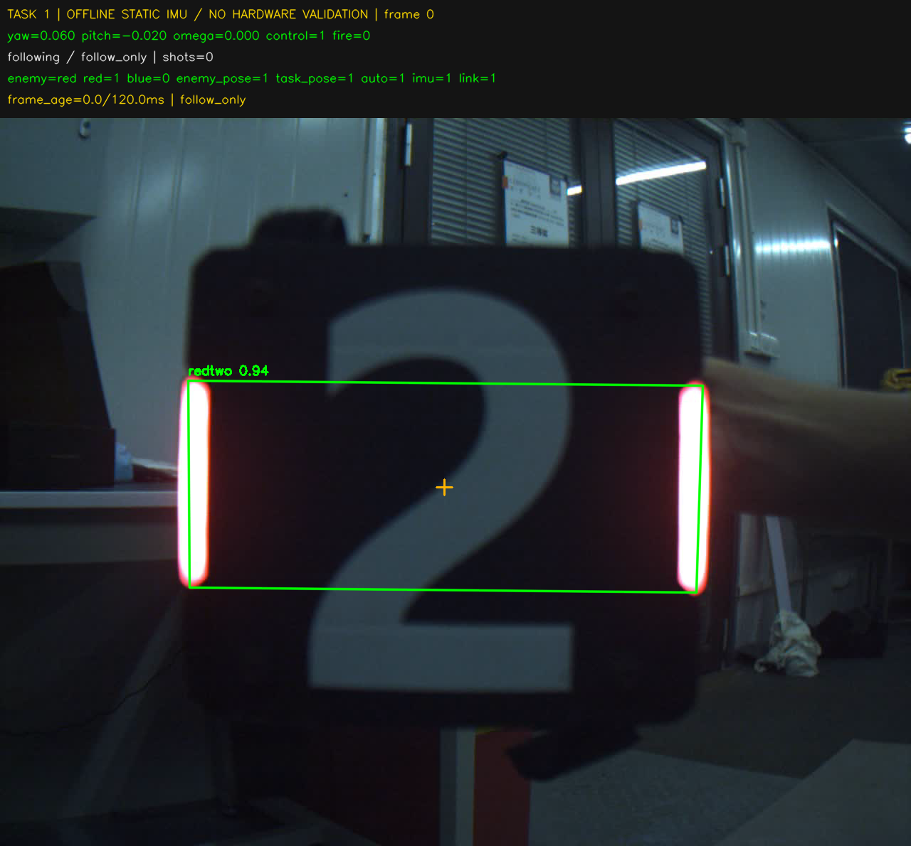

# 任务一定位修复与接口核对

本轮只连接用户的 Ubuntu 22.04 虚拟机，没有连接或启动机器人。
本包用于复测任务一；不宣称三个任务已完成实机验收。

## 原始要求与接口来源

核对用户提供的原始作业后确认：任务一是手持装甲板在 yaw 360°、pitch 约 ±20°
的云台可运动范围内跟随，并输出 Plotter 控制命令。任务一未规定 3 m 距离。
文档中的约 3 m 对应任务二、三；此前仿真的 3 m、±18° 只是测试输入。
单相机仍需目标处于可见、可识别的范围，不能将“360° 云台运动”解释成同时看见全周。

已从上游获取最新 `final_project_aim` 分支 `88f877caa395191a5789a7a99eebd486b8b498f9`，
只更新远程引用，没有覆盖本地实现。它相对初始模板新增车辆交替高度修正；
本项目 `Target::h_armor_xyz` 的 `x[4] + (alternate ? x[10] : 0)` 已包含同一处理。

角度核对依据：

- [2025 上游 Aimer](https://github.com/TongjiSuperPower/sp_vision_25/blob/bd9f5e798fa3c6dd3b483ae6627796afb41c608d/tasks/auto_aim/aimer.cpp)
  使用 `atan2(y,x) + yaw_offset`，pitch 为向上负；配置偏置由度转换成弧度。
- [上游云台响应测试](https://github.com/TongjiSuperPower/sp_vision_25/blob/bd9f5e798fa3c6dd3b483ae6627796afb41c608d/tests/gimbal_response_test.cpp)
  的阶跃测试发送 `limit_rad(cmd_angle / 57.3)`。
- [当前课程串口模板](https://github.com/TongjiSuperPower/sp_vision_tutorial_27/blob/88f877caa395191a5789a7a99eebd486b8b498f9/io/gimbal/gimbal.cpp)
  将 yaw/pitch 浮点值原样装入发送包，速度和加速度字段保持零。

据此沿用绝对弧度角接口，而非擅自改为累计多圈值；移除了开发期间未交付的
`yaw_output` 可选协议。规范化 `(-π,π]` 只是数值表示，不是机械限位。
上游资料不含本车 MCU 固件，故仿真中正确跨界仍不能代替实车跨界复测。

## 已修复

原先任务一与任务二、三共用车辆模型的固定倾角和零横滚约束。
手持板的原始 PnP 可以有效，却因不符合车辆模型被拒绝，出现有框但不跟随。

任务一现在单独使用 `FreeArmor`：比较平面 PnP 候选、进行重投影优化，
使用自由姿态的位置；不再用固定 15° 倾角拒绝手持目标。
仍检查角点、正深度、数值有限、原有 30 m 合理性界限及 5 px 重投影误差。
这不是承诺任意距离、姿态或模糊图像都能可靠定位。
任务二、三保留原车辆/前哨模型和原 IPPE 输入，不借此任意修改 EKF 调参。

新增 `pose_rejections`、`pnp_reprojection_error`、`model_reprojection_error` 等诊断，
区分原始定位失败与模型不匹配；界面显示具体拒绝原因。
任务一仍禁止发射，角速度限制、通信失联停控、俯仰限位保持。

## 本次测试

- CTest 13/13 通过，原始输出见 [CTest 日志](ctest.log)。
- 独立于车辆重投影函数的 1500 个手持姿态案例全部通过，最大位置误差
  `1.66351e-05 m`；样例覆盖 0.8、1.5、3、6 m 及多组俯仰/横滚。
- 18 个投影→定位→控制器测试验证左右方向、跨 ±π、限速和任务一禁止发射。
- 正负偏置及两个方向各超过两圈的纯内存测试通过。
- [完整转圈仿真报告](follow360_report.json)：普通和扰动两场均通过。
- 课程录像 90 帧均有检测，修复后 90 帧有效定位、90 帧产生离线跟随命令、0 发射。
  使用 `offline_cpu.yaml` 的红色课堂录像不是当前蓝色实车；固定单位 IMU 不验证真实运动。
- [全部回归报告](regression_report.json)：22/24 通过，两个中速 ±7 rad/s 扰动案例失败。
  失败项是稳定段最大转速误差；目标重建时估计短时从零开始，最大误差 7 rad/s。
  保留失败判据，没有扩大容许误差或隐藏帧。
- 保留的旧包 `dc063f65b0ad54de40ffd198bee2ccfbc1902ec6` 在同样两个案例中也失败，
  见 [正向旧版指标](baseline_medium_plus7.json) 和 [反向旧版指标](baseline_medium_minus7.json)。
  这说明它们并非本次任务一修复引入，但仍是未解决的问题。

## 任务二三尚不能称为完成的事项

原始作业明确任务二每次 fire 对应单发、5 Hz、每档前 10 发计分，任务三 12 Hz、
30 s。当前串口模板提供累计弹数，但不提供摩擦轮开启位或“下一考核阶段”事件。
因此单发语义不再是待猜测的问题；以下额外假设却不是作业明确保证的接口：

- 0.5 s 内必须收到每发回执以及超时后永久锁存，是本项目额外保护。
  摩擦轮尚未开启或计数延迟时可能造成禁发，不能宣称已适配现场完整流程。
- 用稳定转速变化识别第二档，不能可靠区分 5→5 rad/s 等两个档位同速的情况。
- 任务三以首个 fire 命令开启 30 s 窗口，不等于文档的现场计时信号。
- 上述两个扰动估速案例未通过；部分前哨仿真也没有清除 1500 血量。

本次没有通过删除通信检查、丢目标继续射击、放大发射容差等方式掩盖这些问题。
任务二、三不应据此包直接宣称正式考核完成；需要进一步修正阶段/计时/回执处理，
并在课程负责人在场、遵守原作业安全要求时验证。此包没有修改车载系统环境。
