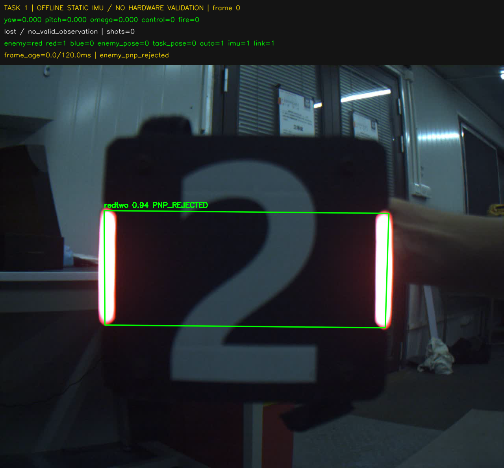

# 2026-10-20 Linux 部署验证

本轮只在 Ubuntu 22.04 x86_64 虚拟机编译和测试，未连接考核小车、相机或发射机构。
现场使用的程序仍需与真实相机标定、GPU/MVS 运行环境和电控接口匹配。

## 已验证

- GCC 11.4、CMake 3.22、OpenCV 4.5.4、OpenVINO 2024.6 构建三个任务成功。
- CTest 12/12 通过；其中命令行拒绝非法输入的用例为 49/49，见 [报告](task_cli.json)。
- 两个红色配置与各自原配置逐行比较：除敌方颜色和说明注释外，其余参数完全相同。
- 使用课程红色车辆装甲板录像，每个任务均处理 90 帧、90 帧有检测、63 帧通过 PnP。
  任务 1 有 65 帧输出跟随命令，任务 2 有 65 帧输出不发射的跟踪命令；包括允许范围内的短时失测沿用。
  任务 3 的有效车辆姿态均被类型门槛拒绝（不是前哨），没有控制或发射输出。
  **这不是任务 3 的正向前哨实测，也不是任何任务的实机跟随或命中证明。**
- 录像使用固定单位 IMU 与文件时间轴，因此 `frame_age_ms=0` 不能用来证明实机图像延迟达标。
- 实测 GTK3/X11 窗口为 960×600 和 800×500；两次均处理完整 90 帧并正常退出。
  原图 1280×1024，输出画布 1280×1190，其中顶部新加 166 像素状态栏。
  两种窗口下，原图四个角的像素块均保持一致，见 [窗口报告](preview_report.json)。
- C++ 单元测试另外对随机图像的完整原图区做逐像素对照，验证状态栏不覆盖、裁切或缩放原图。
- 实际 GUI 验证发现 GTK3 不支持 `WND_PROP_VISIBLE` 查询返回 -1；已取消用该值判定关窗，避免首帧误退出。
  使用窗口内 Q/Esc 或运行终端 Ctrl+C 结束程序。

## 完整视野示例

下图是课程录像第一帧的程序输出，不是当前相机或小车的截图。
这一帧显示 `PNP_REJECTED`，故保留 `control=0`；没有通过放宽门槛伪造“跟随成功”。
状态栏位于原图以外，四边和完整目标区域均保留。



## 复现

在项目根目录运行构建脚本；已有课程录像和图形桌面时，可额外运行 GUI 测试。
GUI 测试需要 Python OpenCV/numpy、`xwininfo`、可访问的 X11/XWayland 显示；它不属于无桌面 CTest 必需项。

```bash
bash scripts/build_tasks.sh build-deploy
python3 tests/test_preview_gui.py --binary build-deploy/task_1 --video /absolute/path/video.avi
```

三个任务的现场逐步命令见仓库根 [README](../../README.md)。
任务 2 的阶段事件、摩擦轮接口和任务 3 的计时起点/命中性能仍需按 README 中的限制与现场对齐。
