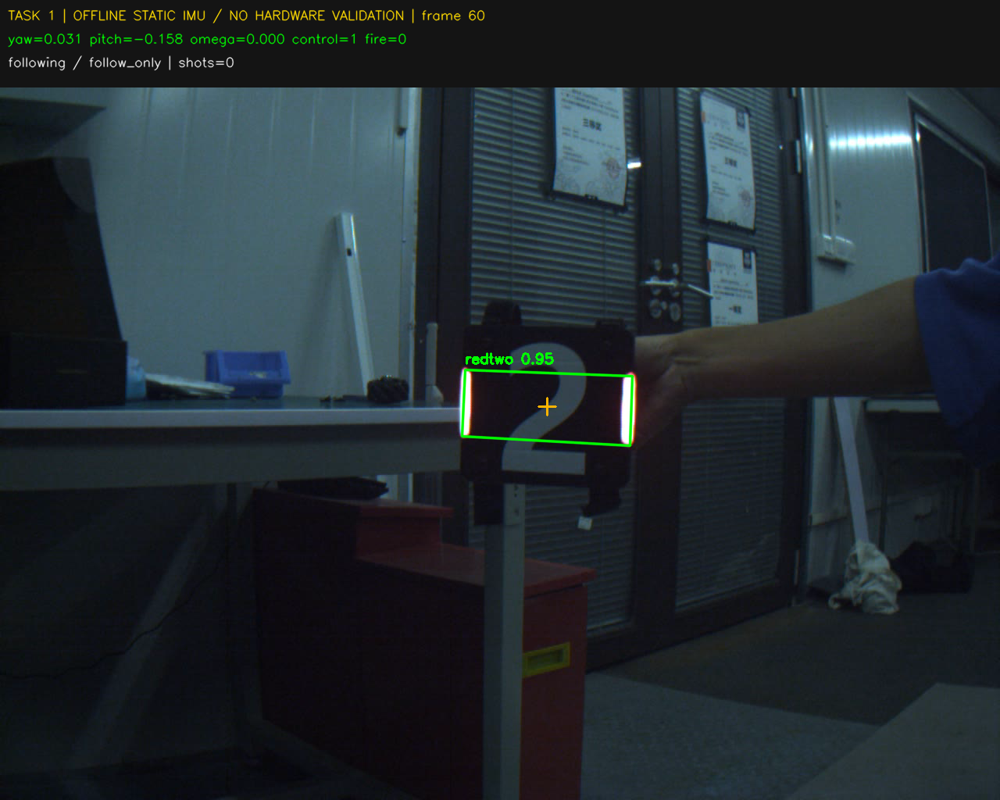
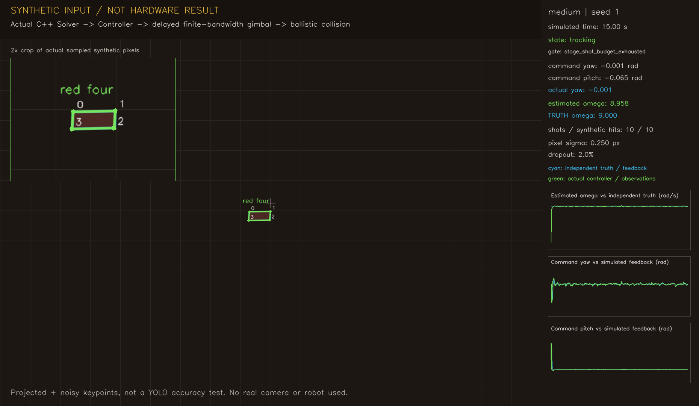
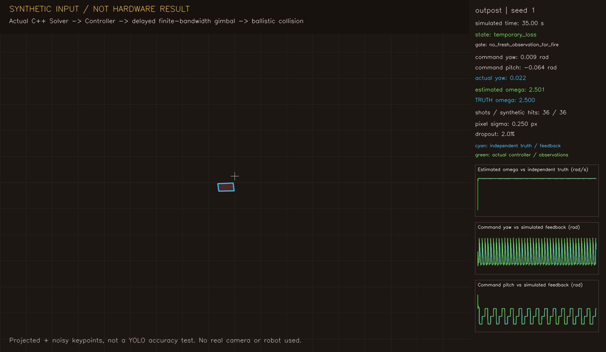

# 虚拟机验证记录

本目录保存 2026-10-13 至 2026-10-14 开发会话的程序真实输出。
**通过的是下面列出的软件测试，不是实机考核；前哨站也没有达到 1500 HP 清空。**
教学讲解与用户提供的参考录屏不包含在这里。

## 来源与环境

- 上游模板：`TongjiSuperPower/sp_vision_tutorial_27` 的 `final_project_aim`，
  基线提交 `8bb1156a54a588284301ad1360c2fc07e3139417`。
- 实现提交：`7b40469`。之后的文档与证据归档不改变算法。
- Ubuntu 22.04.5 / x86_64，CMake 3.22.1，GCC 11，OpenCV 4.5.4，
  Eigen 3.4、yaml-cpp 0.7、fmt 8.1、spdlog 1.9、nlohmann-json 3.10.5。
- 海康 SDK 和 OpenVINO 2024.6 参与编译；录像使用 CPU 推理。
  没有打开真实相机、机器人串口或发射机构。
- 仿真二进制 SHA-256：
  `1cd4e34a12db7654526671f916be6597324b133acfc801d527d1fb9195c0ca3e`。
  两份套件报告都保存二进制原始摘要和源码 canonical-LF 摘要，以便 Windows/Linux 对照。

## 自动测试

- [完整 CTest](2026-10-13/ctest.log)：10/10 组通过。
  覆盖解算、物理评分器、可重复性、UDP 绘图、控制边界、Target/EKF、
  控制器、实际 YOLO 后处理、命令行和伪串口。
- [最终 ASan + UBSan](2026-10-13/sanitizer_final.log)：关闭硬件构建后 7/7 组通过，
  开启泄漏检测和遇错停止，无诊断。初次完整配置/构建日志另见
  [sanitizer.log](2026-10-13/sanitizer.log)。这不代表硬件 SDK 也经过内存检查。
- [命令行](2026-10-13/task_cli.json)：37/37 用例通过；
  非法模式、录像配发射开关、空录像等均安全退出。
- [虚拟串口](2026-10-13/gimbal_transport_repeat.json)：连续 10/10 轮，
  90 个虚拟发送包，最大发送耗时 1.30538 ms；检查长度、CRC、模式、
  非有限输入降级、断流禁控、单发取消、插值和退出。
  仅使用测试自行创建的 PTY，不是机器人通信实测。
- [绘图 UDP](2026-10-13/plotter.json)：实际接收 301 个数据包；
  指令角度、估计转速和单独的仿真真值均为有限数值。

## 合成闭环测试

[标准报告](2026-10-13/suite_report.json)：58/58 场通过。
包括随机种子 1/7/29、正反转、低速 3/4/5、中速 5/7/9 rad/s、
两阶段 4→7 rad/s、前哨 ±2.5 rad/s，以及连续丢帧和异常观测。

稳定段最大绝对转速误差，含常规与压力场：

- 低速：0.227 rad/s，要求范围 ±0.6 rad/s。
- 中速：0.208 rad/s，要求范围 ±1.0 rad/s。
- 前哨：0.0174 rad/s，要求范围 ±0.4 rad/s。

稳定段排除最初 2 秒、切换后的 2 秒，以及压力断流和随后 1 秒恢复；
全时段误差仍保留在报告里，不能把稳定段误差当作从第一帧起的误差。
两阶段测试还分别按低/中速门限验收。

车辆单阶段全部确认 10 发，两阶段全部确认 20 发；这些合成场景均产生对应数量的
独立有限板面碰撞命中。**它不是实机 100% 命中率声明**：没有真实检测误差分布、
弹丸阻力、曝光拖影、机械间隙等。

前哨实际模拟 35 秒以覆盖截止分支，但只把首发后 30 秒内到达板面的命中计分。
有效命中 30–36 发，即 **600–720 HP / 1500 HP**；
不是“30 秒打空前哨”或满分，12 Hz 只是频率上限。

[完整转圈报告](2026-10-13/follow_turn_suite_report.json)：另行 2/2 场通过。
实际云台展开角为 382.058° / 382.065°，俯仰约 ±18°，均不发射。
普通 `follow` 只在 ±π 附近往返，不能用它单独声称 360° 已验证。

原始逐帧/逐发账本：[58 场](2026-10-13/raw_traces.tar.gz)、
[完整转圈 2 场](2026-10-13/follow_turn_raw_traces.tar.gz)。
命中由独立弹丸积分、运动板面碰撞和到达时间判定；
目标中心、速度与真实板号不进入生产控制器。

## 真实录像回放

[录像报告](2026-10-13/perception_evidence/perception_report.json)：
三个任务分别处理已有课程录像的 90 帧，每项 90 次检测、63 次有效 PnP；
均为零发射，未访问硬件。任务 3 对普通装甲板保持不控制。
另外 27 次 PnP 没有被当作有效姿态；不能说这段录像全部姿态都正确。
录像没有同步 IMU，模板标定也没有证明适用于该录像，因此这是流程验证，不是距离精度验证。

## 程序输出截图

截图由实际仿真轨迹渲染，不是 AI 生成图、真实机器人照片或伪造的 Linux 桌面。

另有 [跟随](2026-10-13/follow_tracking.png)、
[完整转圈](2026-10-13/follow360_tracking.png)、
[中速曲线](2026-10-13/medium9_tracking.png)、
[前哨曲线](2026-10-13/outpost_tracking.png)。

## 仍需现场确认

模板缺少摩擦轮启用和明确阶段开始反馈，不能可靠区分所有可能的两阶段流程；
30 秒起点也需与考核裁判对齐。真实标定、弹速、延迟、限位、通信、
电控失联互锁和考核成绩均未验证。详见根目录 README 的阻断项。
不把上述未验证事项隐去，也不以仿真通过代替负责人监督的实机验收。
